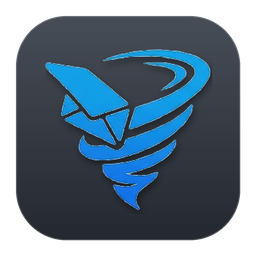
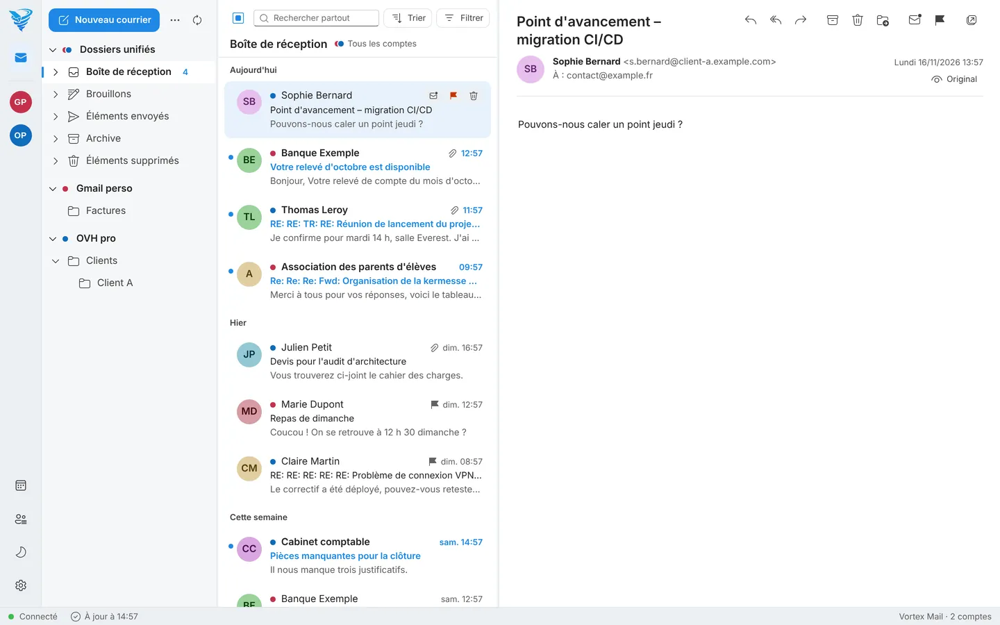
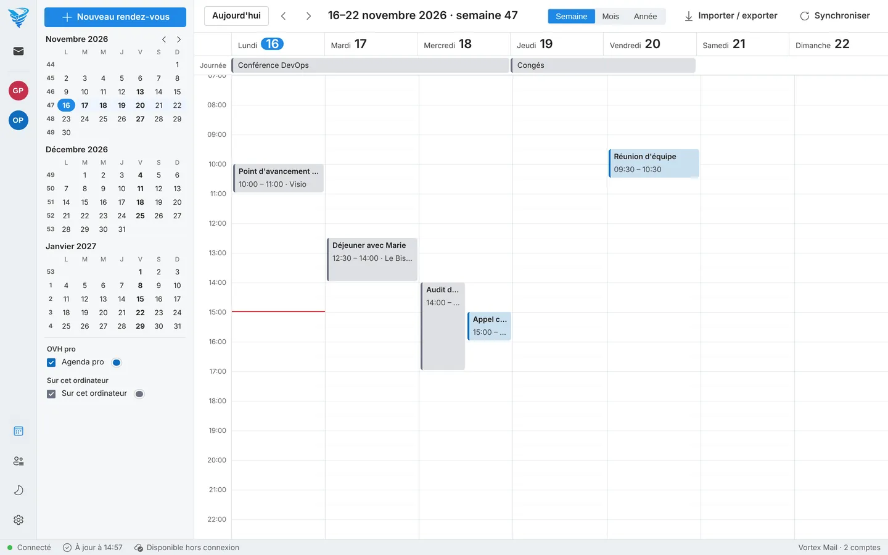
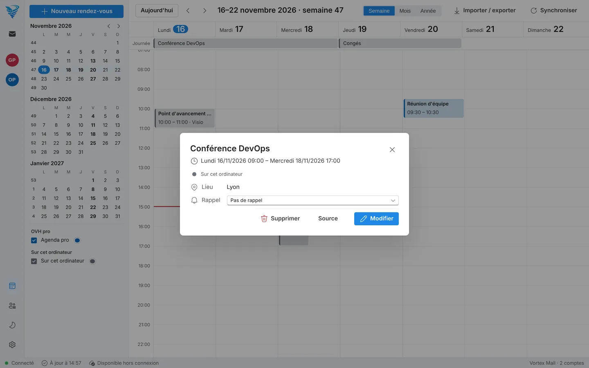
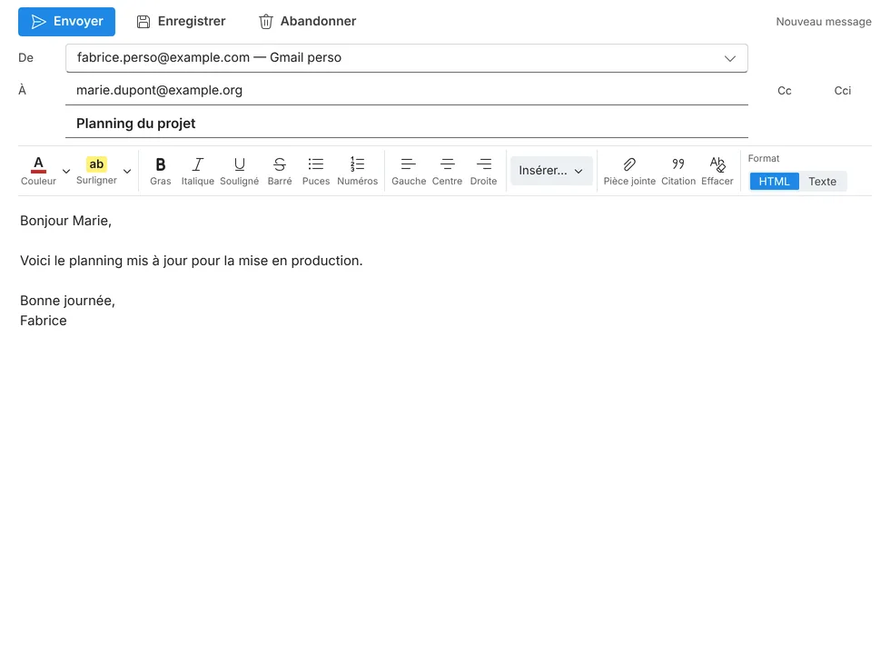

<div align="center">



# Vortex Mail

**Todas tus cuentas de correo en una sola bandeja de entrada, con calendario y contactos.**<br>
Cliente de correo libre para Linux y Windows, escrito en Rust con Tauri.

[](https://github.com/Vidub2001/Vortex-Mail/releases/latest)
[](LICENSE)


[**Descargar**](https://github.com/Vidub2001/Vortex-Mail/releases/latest) · [Sitio web](https://vortexmail.fr/es/) · [Preguntas frecuentes](https://vortexmail.fr/es/faq.html) · [Guías](https://vortexmail.fr/es/guides/) · [Compilación](docs/COMPILATION.es.md) · [Modelo de amenazas](docs/MODELE-MENACE.es.md)

[Français](README.fr.md) · [English](README.md) · **Español**

<br>

<picture><source media="(prefers-color-scheme: dark)" srcset="docs/img/hero-dark.webp"></picture>

</div>

## Por qué Vortex Mail

- **Una bandeja para todas tus cuentas.** Gmail, Outlook.com, cuentas personales de O365 y cualquier servidor IMAP, unificadas o lado a lado.
- **Archivar entre cuentas.** Arrastra un mensaje de una cuenta a una carpeta de otra, o deja que lo hagan las reglas. Los movimientos quedan registrados: no se pierde ni se duplica nada si la red se corta.
- **Calendario y contactos.** Google, Outlook.com, CalDAV y CardDAV, además de calendarios y libretas «En este equipo». Responde a las invitaciones desde el mensaje.
- **Privado por diseño.** Ningún servidor de Vortex Mail, sin publicidad ni telemetría. Los mensajes se muestran sin scripts, las imágenes remotas esperan tu permiso y la caché local está cifrada.
- **S/MIME.** Firma y cifra tus mensajes, comprueba las firmas que recibes.
- **Se adapta a tu forma de trabajar.** Sin conexión, reglas, recordatorios, búsqueda precisa, versión portátil para Windows e interfaz en francés, inglés y español.

<table>
<tr>
<td width="33%" align="center"><picture><source media="(prefers-color-scheme: dark)" srcset="docs/img/agenda-dark.webp"></picture><br><sub>Calendario</sub></td>
<td width="33%" align="center"><picture><source media="(prefers-color-scheme: dark)" srcset="docs/img/fiche-dark.webp"></picture><br><sub>Invitaciones</sub></td>
<td width="33%" align="center"><picture><source media="(prefers-color-scheme: dark)" srcset="docs/img/redaction-dark.webp"></picture><br><sub>Redacción</sub></td>
</tr>
</table>

## Descargar

Las versiones se compilan a partir de este repositorio con GitHub Actions. Cada una incluye `SHA256SUMS` para comprobar los archivos.

| Sistema | Archivo |
|---|---|
| Ubuntu, Debian | paquete `.deb` |
| Cualquier distribución Linux | `AppImage` |
| Windows 10 y 11 | instalador `.exe` |
| Windows, sin instalación | versión portátil `.zip` |

Los archivos de Windows aún no están firmados: Windows puede mostrar un aviso en la primera instalación.

> **Estado:** versión 0.3.2, usada a diario por su autor. Se agradecen los comentarios y los avisos de errores.

## Funciones

<details>
<summary><strong>Todas las funciones</strong></summary>

**Correo**
- Cuentas IMAP/SMTP: SSL/TLS o STARTTLS; contraseña o inicio de sesión OAuth2 (Outlook.com, cuentas
  personales de O365, Gmail).
- Carpetas unificadas (Bandeja de entrada, Enviados, Borradores…) o cuentas separadas; gestión
  completa de carpetas (crear, renombrar, mover, eliminar, vaciar).
- Lectura: HTML aislado y sin scripts, imágenes remotas bloqueadas por defecto, adjuntos (abrir,
  guardar), invitaciones de calendario añadidas,
  actualizadas o retiradas (cancelación) con un clic; respuesta al organizador (Aceptar, Quizás,
  Rechazar), enviada o no, a elección.
- Firmas S/MIME recibidas comprobadas: firmante de confianza, dirección del remitente, mensaje
  modificado tras la firma señalado; detalles del certificado. Autoridades del sistema reservadas
  al correo, o colocadas en la carpeta `smime/autorites` de la configuración.
- Mensajes firmados con S/MIME: certificado por cuenta importado de un archivo .p12 (clave
  guardada en el llavero), botón «Firmar» al redactar, firma predeterminada opcional.
- Mensajes cifrados con S/MIME: leídos con ese mismo certificado, descifrados en memoria (nada
  sin cifrar en el disco); enviados cifrados con el botón «Cifrar», gracias a los certificados de
  los corresponsales guardados de sus mensajes firmados.
- Redacción: HTML o texto sin formato (formato predeterminado configurable), firmas por cuenta,
  responder y reenviar, adjuntos con arrastrar y soltar, borradores guardados automáticamente,
  sugerencias de destinatarios, **aviso de adjunto olvidado**.
- Mover y eliminar entre cuentas, con diario: un movimiento interrumpido (corte de red, aplicación
  cerrada) se reanuda en el siguiente inicio, sin duplicados ni pérdidas.
- Importación y exportación de mensajes: un mensaje en `.eml`, una carpeta en `.mbox` (Descargas); importación de `.eml` y `.mbox` (incluidos los de Thunderbird) en la carpeta elegida.
- Importación y exportación de calendarios (`.ics`) y libretas de direcciones (`.vcf`), sin duplicados al importar dos veces.
- Búsqueda en todas las carpetas de todas las cuentas, incluido el contenido de los mensajes, con criterios: `from:`, `to:`, `subject:`, `before:2026-11-16`, `after:`, `is:unread`, `is:flagged`, `has:attachment`, `"frase exacta"`, `-palabra` para excluir.
- Correo nuevo en tiempo real (IMAP IDLE) y notificaciones de escritorio; sincronización automática
  configurable, incremental en servidores CONDSTORE / QRESYNC (rápida en carpetas grandes).
- **Reglas**: condiciones (remitente, destinatarios, asunto, inicio del mensaje, tiene adjunto) y
  acciones (mover a una carpeta de cualquier cuenta, marcar como leído, marcar con indicador,
  eliminar); se aplican al correo nuevo o a petición; se pueden crear directamente desde un mensaje
  (clic derecho).
- **Segundo plano**: al cerrar la ventana, Vortex Mail sigue en el área de notificación (ajustable
  en Configuración › General); el correo, las reglas y los recordatorios siguen funcionando. Las
  notificaciones de correo nuevo llegan después de las reglas (ninguna para un mensaje que
  eliminan), dos reglas que se devuelven un mensaje ya no lo hacen circular, y los recordatorios
  perdidos con la aplicación cerrada se resumen al iniciar.
- Sin conexión: caché local completa; las acciones se ponen en cola y se repiten cuando vuelve la
  red.

**Calendario y contactos**
- Gmail (OAuth2 de Google, CalDAV/CardDAV), Outlook.com, Mailo/Netcourrier y cualquier servidor
  CalDAV/CardDAV; además, calendarios y libretas de direcciones locales «En este equipo».
- Vistas de semana, mes y año; colores por calendario; números de semana (ISO 8601, semana que
  contiene el 1 de enero o primera semana completa); primer día de la semana y escala de la
  cuadrícula configurables.
- Eventos: repetición (incluidas reglas personalizadas: días de la semana, intervalo, día del mes,
  fin), **recordatorios** (notificaciones de escritorio, sincronizados con los servidores).
- Contactos por cuenta, con nombre y apellidos (orden de visualización configurable).

**Configuración**
- Idioma de la interfaz y de los mensajes de error (francés, inglés, español), tema
  claro/oscuro/del sistema, formatos de fecha y hora, disposición del panel de lectura (a la
  derecha, abajo, oculto).
- **Copia de seguridad** cifrada de toda la configuración (cuentas, contraseñas, ajustes, reglas,
  calendarios y contactos locales) para instalar Vortex Mail en otro equipo.
- **Modo portátil** para Windows: todos los datos junto al ejecutable, protegidos por una
  contraseña maestra.

**Seguridad**
- Ninguna contraseña ni token se escribe en un archivo sin cifrar: todo se guarda en el llavero del
  sistema (GNOME Keyring / Secret Service en Linux, almacén de credenciales de Windows), o en
  el almacén cifrado en modo portátil.
- Copias de seguridad cifradas (PBKDF2-HMAC-SHA256, ChaCha20, HMAC).
- Controles automáticos antes de cada fusión (`make audit`): dependencias (cargo-deny, npm audit),
  reglas Semgrep surgidas de las revisiones, Clippy estricto con las reglas del proyecto, formato,
  pruebas (con recorridos de la interfaz en Chromium) y un corpus de correos trampa; fuzzing de los analizadores (MIME, IMAP, HTML,
  iCalendar, respuestas de red…). Véanse el [modelo de amenazas](docs/MODELE-MENACE.es.md), los
  [controles](docs/AUDIT.es.md) y el [fuzzing](fuzz/README.es.md).

</details>

## Primeros pasos

Requisitos: Rust (estable), Node.js 18+ y las dependencias de sistema de Tauri 2 para su plataforma
(WebKitGTK en Linux, WebView2 en Windows).

```bash
git clone https://github.com/Vidub2001/Vortex-Mail.git vortexmail
cd vortexmail
npm install
npm run tauri dev
```

La primera ejecución compila todas las dependencias de Rust (unos minutos); las siguientes son
rápidas.

Para trabajar solo en la interfaz, sin Rust, con recarga instantánea en el navegador:

```bash
npm run dev
# después abrir http://localhost:1420 (una maqueta en JavaScript sustituye al backend)
```

Pruebas y controles:

```bash
cargo test --workspace   # Rust: lógica principal, IMAP contra un servidor simulado, aplicación
npm test                 # interfaz: calendario, enlaces, reglas, recordatorios
make ui-test             # recorridos de la interfaz en Chromium (npx playwright install chromium)
make audit               # todos los controles (véase docs/AUDIT.es.md)
```

La compilación final, los instaladores, el ZIP portátil para Windows y la resolución de problemas
se describen en **[docs/COMPILATION.es.md](docs/COMPILATION.es.md)**.

## Añadir una cuenta

Configuración (icono de engranaje) → Cuentas → «Agregar cuenta». Su nombre y su dirección bastan:
Vortex Mail busca la configuración (proveedores conocidos, copia integrada de la base de proveedores
de Thunderbird, DNS del dominio, archivo publicado por el dominio y, por último, nombres habituales
comprobados sin contraseña), muestra de dónde procede y prueba la cuenta antes de agregarla. No se
envía ninguna petición a un servicio de terceros, y los servidores fuera de su dominio se señalan.
«Editar a mano» abre el formulario completo, ya rellenado. Proton Mail pasa por Proton Mail Bridge:
su certificado, propio de su equipo, se lee, se confirma una vez y se exige en cada conexión. Tipos de conexión:

| Opción   | IMAP | SMTP | Funcionamiento |
|----------|------|------|----------------|
| SSL/TLS  | 993  | 465  | cifrado desde el inicio |
| STARTTLS | 143  | 587  | conexión sin cifrar que pasa a TLS |
| Auto     |      |      | SSL/TLS en los puertos 993/465, si no STARTTLS |
| Ninguno  | 143  | 25   | contraseña enviada sin cifrar, no recomendado |

«Probar la configuración» comprueba IMAP y SMTP sin guardar nada.

**OAuth2 (Gmail, Outlook.com):** Vortex Mail no incluye credenciales de cliente OAuth.
Registre su propia aplicación (consola de Google Cloud para Gmail, portal de desarrolladores de
Outlook.com para Outlook.com) e introduzca su ID de cliente (y su secreto, en el caso de Google)
en la configuración de la cuenta; se guardan en el llavero y no se vuelven a mostrar.

## Ubicación de los datos

| | Linux | Windows |
|---|---|---|
| Cuentas (`accounts.json`, sin contraseñas) | `~/.config/fr.vortexmail.client/` | `%APPDATA%\fr.vortexmail.client\` |
| Caché de correo, calendario y contactos (`cache.sqlite`) | `~/.local/share/fr.vortexmail.client/` | `%APPDATA%\fr.vortexmail.client\` |
| Contraseñas y tokens | llavero, servicio `vortexmail` | almacén de credenciales de Windows |
| Modo portátil | — | carpeta `data\` junto al ejecutable |

La caché puede borrarse sin riesgo: se reconstruye desde los servidores. Las instalaciones hechas
con el nombre anterior (FluxMail) se migran automáticamente en el primer inicio.

## Estructura del proyecto

<details>
<summary><strong>Ver la estructura del proyecto</strong></summary>

```
crates/imap-lite/        cliente IMAP sin dependencias: protocolo, literales, UTF-7, IDLE, fechas
crates/mail-core/        lógica de negocio, sin interfaz (probada por separado)
  src/model.rs           cuentas, carpetas, mensajes
  src/backend.rs         trait MailBackend (implementado por la demo y por el router IMAP)
  src/ops.rs             movimientos dentro de una cuenta y entre cuentas + diario
  src/compose.rs         construcción de mensajes (MIME, adjuntos, imágenes integradas)
  tests/                 pruebas de movimientos
src-tauri/               capa Tauri (Rust)
  src/router.rs          cuentas IMAP detrás de MailBackend, sincronización, búsqueda
  src/transport.rs       TCP, SSL/TLS, STARTTLS, autenticación IMAP y SMTP, envío
  src/cache.rs           caché SQLite (carpetas, cabeceras, cuerpos, calendarios, contactos)
  src/journal.rs         acciones sin conexión y movimientos pendientes
  src/idle.rs            correo nuevo en tiempo real (IMAP IDLE)
  src/tray.rs            área de notificación
  src/diag.rs            registro de diagnóstico (mensajes saneados)
  src/oauth.rs           OAuth2 de Outlook.com (correo)
  src/o365.rs            calendario y contactos de Outlook.com
  src/endpoints.rs       direcciones técnicas de los servicios
  src/google.rs          OAuth2 de Google (correo, calendario y contactos de Gmail)
  src/dav.rs, pim.rs     CalDAV / CardDAV, sincronización de calendario y contactos
  src/pimfmt.rs          iCalendar y vCard
  src/secrets.rs         contraseñas y tokens en el llavero (o en el almacén portátil)
  src/crypto.rs          cifrado de las copias de seguridad
  src/backup.rs          exportación / importación de la configuración
  src/migrate.rs         migración de las instalaciones de FluxMail
  src/portable.rs        modo portátil (marcador portable.txt, carpeta data)
  src/windows.rs         creación de ventanas
  src/i18n.rs, locales/  idioma de los mensajes generados por el backend (macro tr!)
  src/commands.rs        comandos llamados desde la interfaz
src/                     interfaz React + Fluent UI
  App.tsx, Popup.tsx     ventana principal, ventanas de mensaje y de redacción
  api.ts                 llamadas al backend (o maqueta fuera de Tauri)
  i18n.ts, locales/      idiomas (el francés es el idioma de origen; en.ts y es.ts)
  general.ts, settings.ts  configuración
  rules.ts               reglas de correo
  calendar.ts, recurrence.ts, reminders.ts  calendario: ocurrencias, repetición, recordatorios
  components/            paneles, listas, redacción, calendario, contactos, configuración
docs/COMPILATION*.md     guía de compilación para Linux y Windows (francés, inglés, español)
docs/AUDIT*.md           controles (make audit); MODELE-MENACE*.md: modelo de amenazas
fuzz/, tests/            fuzzing, corpus de no regresión, pruebas de la interfaz
```

</details>

## Hoja de ruta

<details>
<summary><strong>Ya hecho</strong></summary>

- ~~Diario persistente de movimientos entre cuentas; búsqueda en todas las carpetas.~~
- ~~Notificaciones IDLE (correo nuevo en tiempo real).~~
- ~~Redacción y envío (SMTP), responder y reenviar.~~
- ~~Adjuntos: lista, abrir, guardar.~~
- ~~OAuth2 de Outlook.com.~~
- ~~Calendario y contactos (Gmail, Outlook.com, Mailo, CalDAV/CardDAV).~~
- ~~Copia de seguridad y restauración de la configuración; versión para Windows.~~
- ~~Configuración general, reglas, recordatorios, aviso de adjunto, interfaz en tres idiomas.~~
- ~~CONDSTORE / QRESYNC: sincronización incremental de carpetas grandes.~~
- ~~OAuth2 de Google para el correo de Gmail.~~
- ~~Mensajes de error traducidos al inglés y al español.~~
- ~~Versión portátil para Windows (datos junto al ejecutable, contraseña maestra).~~
- ~~Correcciones de la revisión de código de noviembre de 2026 (seguridad, protección de datos,
  zonas horarias del calendario), fuzzing, modelo de amenazas, reglas de código Rust.~~
- ~~Funcionamiento en segundo plano: área de notificación, reglas y notificaciones, recordatorios
  perdidos.~~

</details>

Próximamente:
1. Pulido: arranque más rápido, nombres de carpetas traducidos, primeras pruebas de la
   visualización.
2. Cuentas profesionales y educativas de O365, si surge la necesidad (hoy: solo cuentas personales
   de Outlook.com / O365).

## Limitaciones conocidas

- El inicio de sesión de Google usa su propia aplicación OAuth; mientras esa aplicación esté en
  modo «prueba» en Google, los tokens de Gmail caducan a los 7 días y aparece un aviso para
  reconectar con un clic.
- Los recordatorios y las reglas solo funcionan mientras Vortex Mail está en marcha (ventana
  abierta o icono en el área de notificación).
- En GNOME sin la extensión AppIndicator (activada por defecto en Ubuntu), el icono del área de
  notificación no aparece, pero cerrar la ventana la oculta igualmente: volver a abrir Vortex Mail
  la muestra, o se puede desactivar el ajuste en Configuración › General.
- Las pruebas automáticas de la interfaz cubren su lógica (calendario, enlaces, reglas,
  recordatorios), todavía no la visualización.

## Contribuir

Las incidencias y las contribuciones son bienvenidas. Todo texto de la interfaz, nuevo o
modificado, pasa por `t()` con sus entradas en `src/locales/en.ts` y `src/locales/es.ts`; los
textos generados por el backend en Rust pasan por `tr!` con sus entradas en
`src-tauri/src/locales/`.

## Descargas y firma

Las versiones se compilan a partir de este repositorio con GitHub Actions y se publican en la página de versiones (Releases), con la huella SHA-256 de cada archivo (`SHA256SUMS`). Los archivos de Windows aún no están firmados. Cuando se acepte la solicitud a SignPath Foundation: free code signing provided by [SignPath.io](https://about.signpath.io/), certificate by [SignPath Foundation](https://signpath.org/). Véase la [política de firma](CODE_SIGNING.md).

## Agradecimientos

Gracias a Vincent Corlaix por probar la compatibilidad con Proton Mail (a través de Proton Mail Bridge).

## Licencia

Vortex Mail es software libre, distribuido bajo la licencia GNU GPL versión 3 o (a su elección)
cualquier versión posterior: véase [LICENSE](LICENSE). Las licencias de las bibliotecas utilizadas figuran en
[THIRD_PARTY_LICENSES.txt](THIRD_PARTY_LICENSES.txt).
