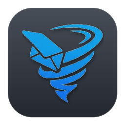
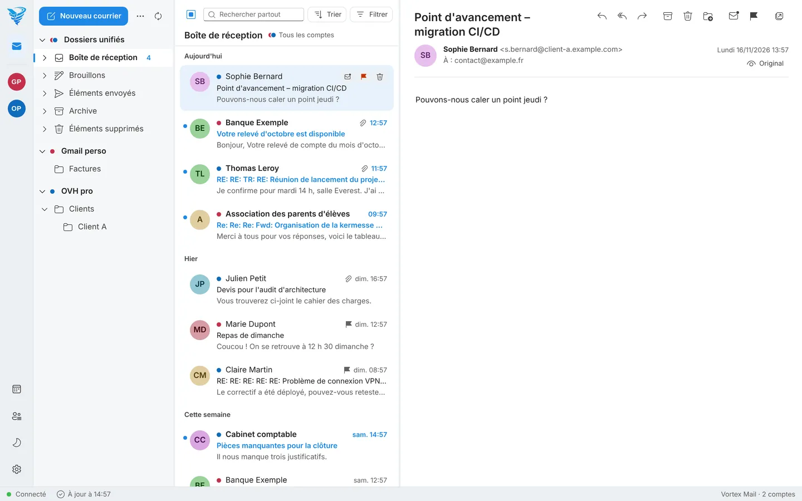
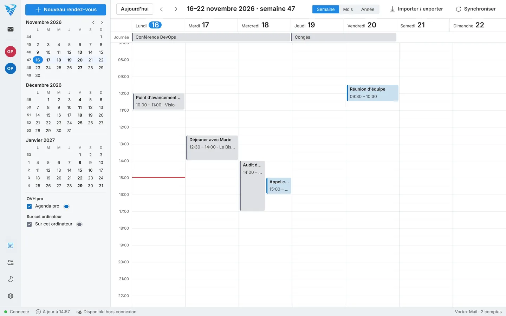
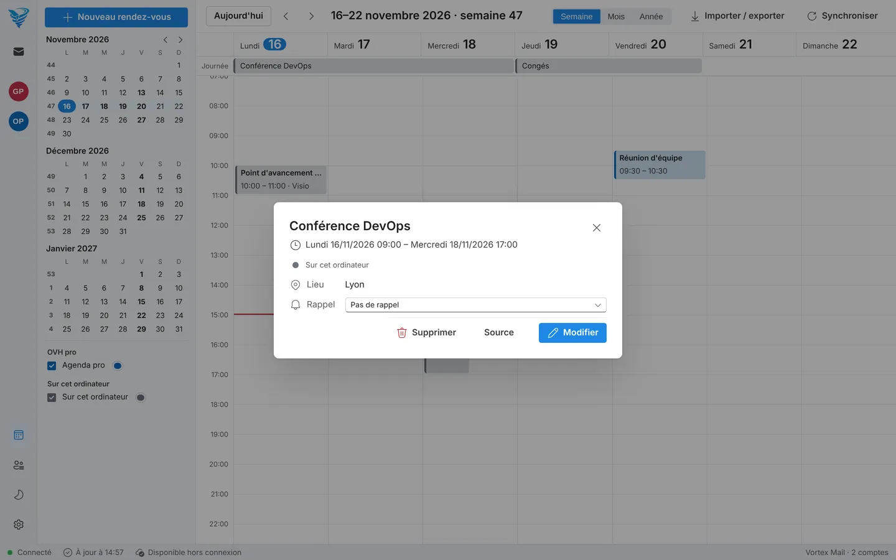
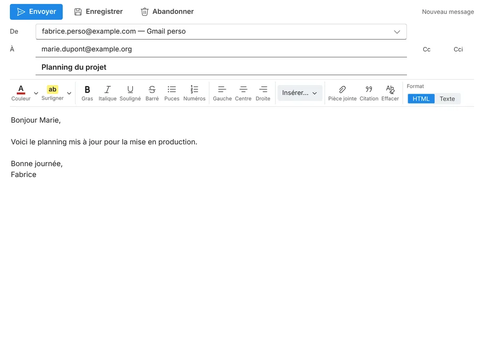

<div align="center">



# Vortex Mail

**Tous vos comptes mail dans une seule boîte de réception, avec l'agenda et les contacts.**<br>
Client de messagerie libre pour Linux et Windows, écrit en Rust avec Tauri.

[](https://github.com/Vidub2001/Vortex-Mail/releases/latest)
[](LICENSE)


[**Télécharger**](https://github.com/Vidub2001/Vortex-Mail/releases/latest) · [Site web](https://vortexmail.fr/fr/) · [FAQ](https://vortexmail.fr/fr/faq.html) · [Guides](https://vortexmail.fr/fr/guides/) · [Compilation](docs/COMPILATION.md) · [Modèle de menace](docs/MODELE-MENACE.md)

**Français** · [English](README.md) · [Español](README.es.md)

<br>

<picture><source media="(prefers-color-scheme: dark)" srcset="docs/img/hero-dark.webp"></picture>

</div>

## Pourquoi Vortex Mail

- **Une boîte pour tous vos comptes.** Gmail, Outlook.com, comptes personnels O365 et tout serveur IMAP, réunis ou côte à côte.
- **Classer d'un compte à l'autre.** Glissez un message d'un compte vers un dossier d'un autre, ou laissez faire les règles. Les déplacements sont journalisés : rien n'est perdu ni dupliqué si le réseau coupe.
- **Agenda et contacts.** Google, Outlook.com, CalDAV et CardDAV, plus des agendas et carnets « Sur cet ordinateur ». Répondez aux invitations depuis le message.
- **Confidentiel par construction.** Aucun serveur Vortex Mail, ni publicité, ni télémétrie. Les messages s'affichent sans script, les images distantes attendent votre accord, le cache local est chiffré.
- **S/MIME.** Signez et chiffrez vos messages, vérifiez les signatures reçues.
- **Adapté à votre façon de travailler.** Hors connexion, règles, rappels, recherche précise, version portable pour Windows et interface en français, anglais et espagnol.

<table>
<tr>
<td width="33%" align="center"><picture><source media="(prefers-color-scheme: dark)" srcset="docs/img/agenda-dark.webp"></picture><br><sub>Agenda</sub></td>
<td width="33%" align="center"><picture><source media="(prefers-color-scheme: dark)" srcset="docs/img/fiche-dark.webp"></picture><br><sub>Invitations</sub></td>
<td width="33%" align="center"><picture><source media="(prefers-color-scheme: dark)" srcset="docs/img/redaction-dark.webp"></picture><br><sub>Rédaction</sub></td>
</tr>
</table>

## Télécharger

Les versions sont construites à partir de ce dépôt par GitHub Actions. Chacune est accompagnée de `SHA256SUMS` pour vérifier les fichiers.

| Système | Fichier |
|---|---|
| Ubuntu, Debian | paquet `.deb` |
| Toute distribution Linux | `AppImage` |
| Windows 10 et 11 | installateur `.exe` |
| Windows, sans installation | version portable `.zip` |

Les fichiers Windows ne sont pas encore signés : Windows peut afficher un avertissement à la première installation.

> **État :** version 0.3.2, utilisée tous les jours par son auteur. Les retours et signalements sont les bienvenus.

## Fonctionnalités

<details>
<summary><strong>Toutes les fonctionnalités</strong></summary>

**Courrier**
- Comptes IMAP/SMTP : SSL/TLS ou STARTTLS ; mot de passe ou connexion OAuth2 (Outlook.com, comptes
  personnels O365, Gmail).
- Boîtes unifiées (réception, envoyés, brouillons…) ou comptes séparés ; gestion complète des
  dossiers (créer, renommer, déplacer, supprimer, vider).
- Lecture : HTML isolé et sans script, images distantes bloquées par défaut, pièces jointes
  (ouverture, enregistrement), invitations d'agenda ajoutées, mises à jour ou retirées
  (annulation) en un clic ; réponse à l'organisateur (Accepter, Peut-être, Refuser), envoyée
  ou non au choix.
- Signatures S/MIME reçues vérifiées : signataire de confiance, adresse de l'expéditeur, message
  modifié après signature signalé ; détails du certificat. Autorités du système réservées au
  courrier, ou déposées dans le dossier `smime/autorites` des réglages.
- Messages signés en S/MIME : certificat importé d'un fichier .p12 par compte (clé gardée dans
  le trousseau), bouton « Signer » dans la rédaction, signature par défaut réglable.
- Messages chiffrés en S/MIME : lus avec ce même certificat, déchiffrés en mémoire (rien en clair
  sur le disque) ; envoyés chiffrés avec le bouton « Chiffrer », grâce aux certificats des
  correspondants gardés sur leurs messages signés.
- Rédaction : HTML ou texte simple (format par défaut réglable), signatures par compte, réponses et
  transferts, pièces jointes par glisser-déposer, brouillons enregistrés automatiquement,
  suggestions de destinataires, **avertissement de pièce jointe oubliée**.
- Déplacement et suppression entre comptes, avec journal : un déplacement interrompu (coupure
  réseau, fermeture) est repris au démarrage suivant, sans doublon ni perte.
- Import et export des messages : un message en `.eml`, un dossier en `.mbox` (Téléchargements) ; import de `.eml` et `.mbox` (Thunderbird compris) dans le dossier choisi.
- Import et export des agendas (`.ics`) et des carnets d'adresses (`.vcf`), sans doublon à un second import.
- Recherche dans tous les dossiers de tous les comptes, contenu compris, avec critères : `de:`, `à:`, `objet:`, `avant:16/11/2026`, `après:`, `est:nonlu`, `est:suivi`, `avec:pj`, `"phrase exacte"`, `-mot` pour exclure.
- Nouveaux messages en temps réel (IMAP IDLE) et notifications du bureau ; synchronisation
  automatique réglable, incrémentale sur les serveurs CONDSTORE / QRESYNC (rapide sur les grands
  dossiers).
- **Règles** : conditions (expéditeur, destinataires, objet, début du message, pièce jointe) et
  actions (déplacer vers un dossier de n'importe quel compte, marquer lu, indicateur, supprimer) ;
  appliquées aux nouveaux messages ou à la demande ; création directement depuis un message
  (clic droit).
- **Arrière-plan** : fermer la fenêtre garde Vortex Mail dans la zone de notification (réglable
  dans Paramètres › Général) ; la réception, les règles et les rappels continuent. Les
  notifications de nouveaux messages arrivent après les règles (aucune pour un message qu'elles
  suppriment), deux règles qui se renvoient un message ne le font pas circuler, et les rappels
  manqués pendant la fermeture sont résumés au démarrage.
- Hors connexion : cache local complet ; les actions sont mises en attente et rejouées au retour du
  réseau.

**Agenda et contacts**
- Gmail (OAuth2 Google, CalDAV/CardDAV), Outlook.com, Mailo/Netcourrier et tout serveur
  CalDAV/CardDAV ; agendas et carnets d'adresses « Sur cet ordinateur ».
- Vues semaine, mois et année ; couleur par agenda ; numéros de semaine (ISO 8601, semaine du
  1er janvier ou première semaine complète) ; premier jour de la semaine et échelle de la grille
  réglables.
- Rendez-vous : répétitions (y compris personnalisées : jours de la semaine, intervalle, jour du
  mois, fin), **rappels** (notifications du bureau, synchronisés avec les serveurs).
- Contacts par compte, avec prénom et nom (ordre d'affichage réglable).

**Réglages**
- Langue de l'interface et des messages d'erreur (français, anglais, espagnol), thème
  clair/sombre/système, formats de date et d'heure, disposition du volet de lecture (à droite,
  en bas, masqué).
- **Sauvegarde** chiffrée de toute la configuration (comptes, mots de passe, réglages, règles,
  agendas et contacts locaux) pour installer Vortex Mail sur une autre machine.
- **Mode portable** pour Windows : toutes les données à côté de l'exécutable, protégées par un mot
  de passe maître.

**Sécurité**
- Aucun mot de passe ni jeton n'est écrit dans un fichier en clair : tout est dans le trousseau du
  système (GNOME Keyring / Secret Service sous Linux, coffre d'identifiants de Windows),
  ou dans le coffre chiffré en mode portable.
- Sauvegardes chiffrées (PBKDF2-HMAC-SHA256, ChaCha20, HMAC).
- Contrôles automatiques avant chaque fusion (`make audit`) : dépendances (cargo-deny, npm audit),
  règles Semgrep tirées des relectures, Clippy strict avec les règles du projet, mise en forme,
  tests (dont parcours de l'interface dans Chromium) et corpus de mails piégés ; fuzzing des lecteurs (MIME, IMAP, HTML, iCalendar, réponses
  réseau…). Voir le [modèle de menace](docs/MODELE-MENACE.md), les [contrôles](docs/AUDIT.md) et le [fuzzing](fuzz/README.md).

</details>

## Démarrage

Prérequis : Rust (stable), Node.js 18+ et les dépendances système de Tauri 2 pour votre plateforme
(WebKitGTK sous Linux, WebView2 sous Windows).

```bash
git clone https://github.com/Vidub2001/Vortex-Mail.git vortexmail
cd vortexmail
npm install
npm run tauri dev
```

Le premier lancement compile toutes les dépendances Rust (quelques minutes) ; les suivants sont
rapides.

Pour travailler uniquement l'interface, sans Rust, avec rechargement instantané dans le
navigateur :

```bash
npm run dev
# puis ouvrir http://localhost:1420 (une maquette JavaScript remplace le backend)
```

Tests et contrôles :

```bash
cargo test --workspace   # Rust : cœur métier, IMAP contre un faux serveur, application
npm test                 # interface : agenda, liens, règles, rappels
make ui-test             # parcours de l'interface dans Chromium (npx playwright install chromium)
make audit               # tous les contrôles (voir docs/AUDIT.md)
```

La compilation en version finale, les installateurs, le ZIP portable pour Windows et le dépannage
sont décrits dans **[docs/COMPILATION.md](docs/COMPILATION.md)**.

## Ajouter un compte

Paramètres (engrenage) → Comptes → « Ajouter un compte ». Votre nom et votre adresse suffisent :
Vortex Mail cherche les réglages (fournisseurs connus, copie intégrée de la base des fournisseurs
de Thunderbird, DNS du domaine, fichier publié par le domaine, puis noms habituels essayés sans mot
de passe), montre d'où ils viennent, puis teste le compte avant de l'ajouter. Aucune requête ne
part vers un service tiers, et des serveurs hors de votre domaine sont signalés. « Modifier à la
main » ouvre le formulaire complet, prérempli. Proton Mail passe par Proton Mail Bridge : son
certificat, propre à votre ordinateur, est lu, confirmé une fois puis exigé à chaque connexion. Types de connexion :

| Choix    | IMAP | SMTP | Fonctionnement |
|----------|------|------|----------------|
| SSL/TLS  | 993  | 465  | chiffré dès la connexion |
| STARTTLS | 143  | 587  | connexion en clair puis passage en TLS |
| Auto     |      |      | SSL/TLS sur les ports 993/465, sinon STARTTLS |
| Aucun    | 143  | 25   | mot de passe en clair, déconseillé |

« Tester les paramètres » vérifie l'IMAP et le SMTP sans rien enregistrer.

**OAuth2 (Gmail, Outlook.com) :** Vortex Mail n'embarque aucun identifiant client OAuth.
Enregistrez votre propre application (console Google Cloud pour Gmail, portail développeur
d'Outlook.com pour Outlook.com), puis saisissez son ID client (et son secret pour Google) dans les
réglages du compte ; ils sont rangés dans le trousseau et ne sont plus jamais affichés.

## Emplacement des données

| | Linux | Windows |
|---|---|---|
| Comptes (`accounts.json`, sans mot de passe) | `~/.config/fr.vortexmail.client/` | `%APPDATA%\fr.vortexmail.client\` |
| Cache du courrier, de l'agenda et des contacts (`cache.sqlite`) | `~/.local/share/fr.vortexmail.client/` | `%APPDATA%\fr.vortexmail.client\` |
| Mots de passe et jetons | trousseau, service `vortexmail` | coffre d'identifiants de Windows |
| Mode portable | — | dossier `data\` à côté de l'exécutable |

Le cache peut être supprimé sans risque : il est reconstruit depuis les serveurs. Les
installations faites sous l'ancien nom (FluxMail) sont reprises automatiquement au premier
démarrage.

## Organisation du projet

<details>
<summary><strong>Voir l'organisation du projet</strong></summary>

```
crates/imap-lite/        client IMAP sans dépendance : protocole, littéraux, UTF-7, IDLE, dates
crates/mail-core/        logique métier, sans interface (testée seule)
  src/model.rs           comptes, dossiers, messages
  src/backend.rs         trait MailBackend (implémenté par la démo et par le routeur IMAP)
  src/ops.rs             déplacements dans un compte et entre comptes + journal
  src/compose.rs         construction des messages (MIME, pièces jointes, images intégrées)
  tests/                 tests des déplacements
src-tauri/               couche Tauri (Rust)
  src/router.rs          comptes IMAP derrière MailBackend, synchronisation, recherche
  src/transport.rs       TCP, SSL/TLS, STARTTLS, authentification IMAP et SMTP, envoi
  src/cache.rs           cache SQLite (dossiers, en-têtes, corps, agendas, contacts)
  src/journal.rs         actions hors connexion et déplacements à reprendre
  src/idle.rs            nouveaux messages en temps réel (IMAP IDLE)
  src/tray.rs            zone de notification
  src/diag.rs            journal de diagnostic (messages nettoyés)
  src/oauth.rs           OAuth2 Outlook.com (courrier)
  src/o365.rs            agenda et contacts Outlook.com
  src/endpoints.rs       adresses techniques des services
  src/google.rs          OAuth2 Google (courrier, agenda, contacts Gmail)
  src/dav.rs, pim.rs     CalDAV / CardDAV, synchronisation de l'agenda et des contacts
  src/pimfmt.rs          iCalendar et vCard
  src/secrets.rs         mots de passe et jetons dans le trousseau (ou le coffre portable)
  src/crypto.rs          chiffrement des sauvegardes
  src/backup.rs          export / import de la configuration
  src/migrate.rs         reprise des installations FluxMail
  src/portable.rs        mode portable (marqueur portable.txt, dossier data)
  src/windows.rs         création des fenêtres
  src/i18n.rs, locales/  langue des messages produits par le backend (macro tr!)
  src/commands.rs        commandes appelées par l'interface
src/                     interface React + Fluent UI
  App.tsx, Popup.tsx     fenêtre principale, fenêtres de message et de rédaction
  api.ts                 appels au backend (ou maquette hors Tauri)
  i18n.ts, locales/      langues (le français est la langue source ; en.ts et es.ts)
  general.ts, settings.ts  réglages
  rules.ts               règles de classement
  calendar.ts, recurrence.ts, reminders.ts  agenda : occurrences, répétitions, rappels
  components/            volets, listes, rédaction, agenda, contacts, paramètres
docs/COMPILATION*.md     compilation sous Linux et Windows (français, anglais, espagnol)
docs/AUDIT*.md           contrôles (make audit) ; MODELE-MENACE*.md : modèle de menace
fuzz/, tests/            fuzzing, corpus de non-régression, tests de l'interface
```

</details>

## Feuille de route

<details>
<summary><strong>Déjà fait</strong></summary>

- ~~Journal persistant des déplacements entre comptes ; recherche dans tous les dossiers.~~
- ~~Notifications IDLE (nouveaux messages en temps réel).~~
- ~~Rédaction et envoi (SMTP), réponses et transferts.~~
- ~~Pièces jointes : liste, ouverture, enregistrement.~~
- ~~OAuth2 Outlook.com.~~
- ~~Agenda et contacts (Gmail, Outlook.com, Mailo, CalDAV/CardDAV).~~
- ~~Sauvegarde et reprise de la configuration ; version Windows.~~
- ~~Réglages généraux, règles, rappels, alerte pièce jointe, interface en trois langues.~~
- ~~CONDSTORE / QRESYNC : synchronisation incrémentale des grands dossiers.~~
- ~~OAuth2 Google pour le courrier Gmail.~~
- ~~Messages d'erreur traduits en anglais et en espagnol.~~
- ~~Version portable pour Windows (données à côté de l'exécutable, mot de passe maître).~~
- ~~Corrections de la relecture du code de novembre 2026 (sécurité, protection des données, fuseaux
  horaires de l'agenda), fuzzing, modèle de menace, règles de code Rust.~~
- ~~Fonctionnement en arrière-plan : zone de notification, règles et notifications, rappels manqués.~~

</details>

À venir :
1. Finitions : démarrage plus rapide, noms de dossiers traduits, premiers tests de l'affichage.
2. Comptes O365 professionnels et scolaires, si le besoin apparaît (aujourd'hui : comptes
   personnels Outlook.com / O365 uniquement).

## Limites connues

- La connexion Google utilise votre propre application OAuth ; tant qu'elle est en mode « test »
  chez Google, les jetons Gmail expirent au bout de 7 jours et un bandeau de reconnexion en un clic
  apparaît.
- Les rappels et les règles ne fonctionnent que lorsque Vortex Mail tourne (fenêtre ouverte ou
  icône dans la zone de notification).
- Sous GNOME sans l'extension AppIndicator (présente par défaut sous Ubuntu), l'icône de la zone
  de notification n'apparaît pas, mais fermer la fenêtre la cache quand même : relancer Vortex Mail
  la fait réapparaître, ou décocher le réglage dans Paramètres › Général.
- Les tests automatiques de l'interface couvrent la logique (agenda, liens, règles, rappels), pas
  encore l'affichage.

## Contribuer

Les signalements et les contributions sont les bienvenus. Tout texte de l'interface, nouveau ou
modifié, passe par `t()` avec ses entrées dans `src/locales/en.ts` et `src/locales/es.ts` ; les
textes produits par le backend Rust passent par `tr!` avec leurs entrées dans
`src-tauri/src/locales/`.

## Téléchargement et signature

Les versions sont construites à partir de ce dépôt par GitHub Actions et publiées dans la page des versions (Releases), avec l'empreinte SHA-256 de chaque fichier (`SHA256SUMS`). Les fichiers Windows ne sont pas encore signés. Une fois la candidature à SignPath Foundation acceptée : free code signing provided by [SignPath.io](https://about.signpath.io/), certificate by [SignPath Foundation](https://signpath.org/). Voir la [politique de signature](CODE_SIGNING.md).

## Remerciements

Merci à Vincent Corlaix, qui a testé la prise en charge de Proton Mail (par Proton Mail Bridge).

## Licence

Vortex Mail est un logiciel libre, distribué sous licence GNU GPL version 3 ou (à votre choix)
toute version ultérieure : voir [LICENSE](LICENSE). Les licences des bibliothèques utilisées sont listées dans
[THIRD_PARTY_LICENSES.txt](THIRD_PARTY_LICENSES.txt).
